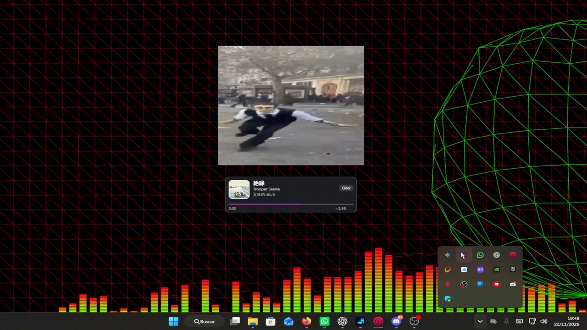

# WirePulse, Dale marcha a tu fondo de escritorio

[English](README.md)

Un fondo reactivo al audio para **Windows, macOS y Linux Mint / Cinnamon X11**.

- Mueve, redimensiona, gira y ordena objetos en el editor de escritorio.
- Añade orbes, visualizadores, relojes, textos animados, imágenes, GIF y widgets HTML.
- Personaliza colores y gradientes; importa y exporta diseños entre sistemas.
- Muestra canción y portada de reproductores compatibles, incluido Cider.
- Usa diseños compartidos o independientes en varias pantallas.
- Busca actualizaciones de GitHub mediante canales estable y beta.

## Descargar

**[Descargar la última versión](https://github.com/JLiveOf/wirepulse/releases/latest)**

| Sistema | Paquete |
| --- | --- |
| Windows 10/11 x64 | `win-x64-Setup.exe` o `.zip` portátil |
| macOS 14.2+, Apple silicon | `macOS-arm64.zip` — mueve la app a Aplicaciones |
| Linux Mint / Cinnamon **X11**, x64 | `.deb` o `linux-x64.tar.gz` portátil |

Los fondos de vídeo en Linux necesitan FFmpeg. El audio y las portadas pueden solicitar permisos del sistema. La app de macOS lleva firma ad hoc y no está notarizada; Windows no lleva firma comercial.

## Editar el escritorio

Abre WirePulse desde la bandeja o barra de menús → **Editar escritorio**. Añade objetos, arrástralos y guarda. Las propiedades de cada objeto incluyen formato de texto, animación y gradientes.

**[Ver la demo: añadir y editar elementos](docs/media/editor-demo.mp4)**

En Ajustes → **Inicio** están el idioma, el inicio de sesión y las actualizaciones. El idioma se aplica al reiniciar. El canal beta incluye las prereleases de GitHub. La app pregunta antes de descargar y recuerda la versión omitida o la decisión de no volver a preguntar. Las actualizaciones `.deb` de Linux abren el instalador de paquetes del sistema.

## Compilar

[Windows / Linux](desktop/README.es.md) · [macOS](macos/README.es.md) · [Comunicar un fallo](https://github.com/JLiveOf/wirepulse/issues)
